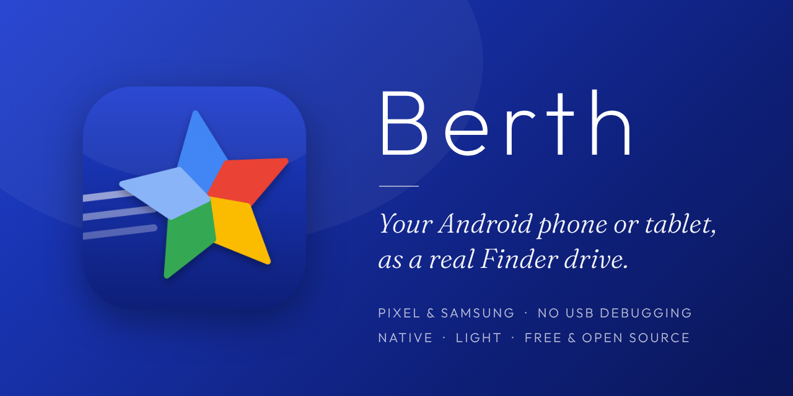
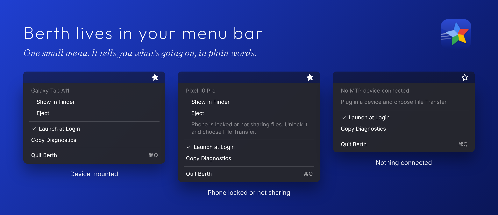

<p align="center">
  
</p>

<h1 align="center">Berth</h1>

<p align="center">Your Android phone or tablet as a real Finder volume. Small, fast, silent.</p>

Berth is a macOS menu bar app that mounts MTP devices (Android phones and tablets, cameras, e-readers) as ordinary Finder volumes under `~/Berth`. Plug in, unlock the device, set USB to **File transfer**, and it appears in Finder. No transfer window, no drivers, no kernel or system extensions.

Berth is a fork of Moorage by Skyler Schoos ([github.com/skuthus/Moorage](https://github.com/skuthus/Moorage), MIT). Moorage's architecture is unchanged: a private in-process WebDAV bridge mounted with macOS's own `mount_webdav`. See [Credits](#credits).

## What it looks like

<p align="center">
  
</p>

*Illustration of the menu. Real screenshots to follow.*

## What Berth changes

- **New USB transport (IOUSBLib).** The same interface API libusb uses, replacing IOUSBHost. This is what makes Pixel phones, whose MTP server is touchy, mount reliably.
- **Self-healing sessions.** Devices that re-enumerate on USB after mounting (Samsung tablets do this) no longer leave an empty volume. Berth detects the replaced interface and reconnects on its own.
- **Gentler connect.** One connect at a time, no USB reset, no stale-pipe drain before the first command, bounded retries.
- Friendly device names (for example "Galaxy Tab A11") for the volume.

- **Tells you what's wrong.** A locked phone, or one on "Charging only" / "No data transfer", shows "Phone is locked or not sharing files" in the menu, and the message clears the moment sharing starts.
- **Quick plug and unplug.** Measured on a Samsung Galaxy Tab A11: about 0.9 s from plug-in to a usable volume (USB open 127 ms, storage ready about 0.6 s, mount about 0.1 s), unmount 26 ms, and an unplug is confirmed in 0.6 s. The volume returns on its own after sleep or a replug.
- **Copy Diagnostics** in the menu puts a redacted report (device, USB IDs, recent log) on the clipboard for bug reports.

Tested on a Samsung Galaxy Tab A11 and a Google Pixel 10 Pro. Other devices are likely to work (Berth finds MTP by its USB interface, not by model) but are untested: please report results.

## How it compares

| | Finder volume | Needs USB debugging | Price | Notes |
|---|---|---|---|---|
| **Berth** | Yes | No | Free, MIT | Pure Swift, no libusb/libmtp |
| MacDroid | Yes | Yes | Free (read-only), Pro $19.99/yr | Closed source |
| OpenMTP | No (transfer window) | No | Free, MIT | Mature, uses its own MTP kernel |
| SwiftMTP | No (own window) | No | Free, GPL | Unnotarized |
| MTPort / FreeDroid / adbdav / adbmount | Yes | Varies | Free, open source | Build from source, early |

Berth is not the fastest option: ADB-based tools reach roughly 17-20 MB/s over USB but need USB debugging turned on. Berth needs nothing enabled on the phone.

## Requirements

- macOS 26 or later, Apple Silicon or Intel
- A device that speaks MTP, set to **File transfer** mode
- Quit other MTP tools (OpenMTP, Android File Transfer, MacDroid) first. Only one program can hold a device at a time.

## Install

Open `Berth.dmg` and drag Berth to Applications. Builds without an Apple Developer ID are not notarized: the first time, right-click Berth and choose **Open**.

## Using it

1. Plug in the device, unlock it, choose **File transfer** in the USB notification.
2. The volume appears in Finder under `~/Berth`.
3. Eject from the menu bar item or Finder before unplugging.

**Troubleshooting**

- *Empty volume, or the menu says "Phone is locked or not sharing files":* unlock the phone and choose **File transfer** in the USB notification. Android 15 and newer block USB data while the screen is locked.
- *Won't mount:* use a data cable (not charge-only), try another port, and quit Android File Transfer, OpenMTP, MacDroid, Image Capture and Photos. Only one program can hold the device.
- *First connection is slow:* some phones need up to a minute to publish storage.
- Still stuck? Choose **Copy Diagnostics** from the menu and paste the result into an issue. The log is at `~/Library/Logs/Berth.log`.

**File safety.** Overwrites are staged under a hidden name and swapped in, so a failed copy leaves the original file intact. Finder junk (`.DS_Store`, `._*`) is never written to the device.

## Building

SwiftPM plus build scripts, no Xcode project.

```
Scripts/build-app.sh            # build + sign dist/Berth.app
Scripts/build-app.sh --install  # also install to /Applications and launch
Scripts/make-dmg.sh             # dist/Berth.dmg
swift run BerthSelfCheck        # protocol tests, no device needed
```

See [docs/DESIGN.md](docs/DESIGN.md) and [docs/PITFALLS.md](docs/PITFALLS.md).

## Credits

Berth is built on **Moorage** by Skyler Schoos, used under the MIT License. Both copyright notices are kept in [LICENSE](LICENSE).

## License

MIT. See [LICENSE](LICENSE).
